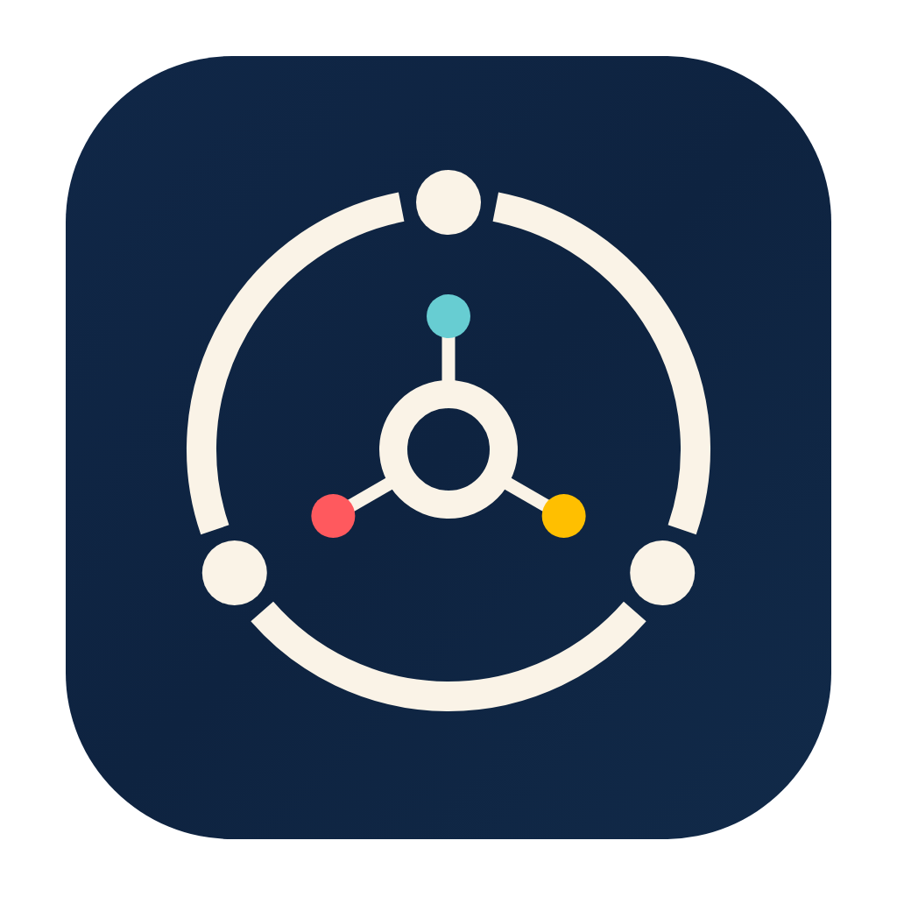

<p align="center">
  
</p>

<h1 align="center">Corptie</h1>

<p align="center">
  <strong>Burn tokens more efficiently.</strong>
</p>

<p align="center">
  <a href="https://github.com/soapjk/corptie/releases">Downloads and releases</a>
  ·
  <a href="README.md">简体中文</a>
</p>

Corptie brings projects, tasks, AI sessions, and Git into one workspace. Discuss requirements, run tasks in parallel, and review results in one place. Keep working from your iPhone or iPad when you step away from your desk.

## Features

| Feature | What you can do |
| --- | --- |
| **Projects and tasks** | Organize projects with Work and break goals into Tasks, keeping discussions, progress, and results together. |
| **Multiple AI runtimes** | Use Codex, Claude Code, or OpenClacky for your tasks. Available capabilities depend on the selected runtime. |
| **Session collaboration** | Let sessions across tasks and projects communicate directly. Ask another project to adapt to an API you just changed, without copying context between windows. |
| **Parallel development and Git** | Work on tasks in separate Worktrees. Review changes, commit, sync, merge, and push; ask a session to help resolve conflicts. |
| **Agents and Skills** | Save and reuse roles, working instructions, and skills. |
| **Artifacts and memory** | Save, search, and revisit document versions. Keep user preferences, project context, and task knowledge available to sessions. |
| **Automations** | Schedule work once or repeatedly, or resume when a process exits or a condition is met, without watching long jobs. |
| **Status and notifications** | Follow execution and get notified when tasks finish, become blocked, or fail. |
| **Feishu integration** | Participate through a Feishu bot and manage sessions with `/sessions`. |

## iPhone and iPad

**Run on your Mac. Continue on mobile.** Connect to your Mac to:

- Browse projects, tasks, and live conversations; send messages and images or stop the current run.
- Create and manage Work and Tasks, consult artifacts and memories, and check automation status.
- Manage Worktrees, review integration plans, commit, sync, merge, and push to GitHub.
- Receive task status notifications and open the relevant session.

Choose how to connect:

- **Local network pairing:** Generate a QR code in your Mac's device access settings, scan it on mobile, and approve the request on your Mac.
- **Cloud remote access:** Sign in to the same Corptie Cloud account on both devices and enable remote access on your Mac to connect over the internet. Communication is end-to-end encrypted.

Your Mac must stay running and reachable. Some settings and management actions still require the Mac. Instant notifications are not guaranteed while the mobile app is suspended. See release notes for mobile installation availability, or [install from source](#run-from-source).

## Get started

The desktop app requires an **Apple Silicon Mac running macOS 14 or later** and at least one authenticated Codex, Claude Code, or OpenClacky runtime.

1. Install Corptie from [GitHub Releases](https://github.com/soapjk/corptie/releases) and check that your chosen AI runtime is available.
2. Create a Work, link your local project folder, and choose a role and skills.
3. Discuss the work, create a Task with a clear goal and acceptance criteria, and start a session.
4. Review results and code changes, then merge. Continue following up on mobile as needed.

Project execution and artifacts stay on your Mac by default. Model requests and enabled external tools use the network according to their configuration.

## Run from source

Install Node.js 22.13+, Swift 6, Rust / Cargo, and Python 3. Mobile builds also require Xcode and device signing.

```sh
npm ci --prefix apps/backend
npm --prefix apps/backend run build:native
make dev
```

After code changes, rebuild and restart the development app:

```sh
scripts/dev-rebuild-restart.sh
```

The rebuild entry point requires an external volume path and defaults to `/Volumes/T9/CorptieData/development-launcher`. Set `CORPTIE_DEVELOPMENT_RUNTIME_ROOT` to an actual `/Volumes/...` path on your Mac.

To install the mobile development app, connect and unlock your iPhone or iPad, sign in to Xcode, trust the Mac, and enable Developer Mode:

```sh
make mobile
# Select a device by name or UDID; add TEAM=your-team-id if needed
make mobile DEVICE="device-name-or-UDID"
```

See [Makefile](Makefile) and [scripts](scripts) for more commands. The mobile project is in [apps/ipad](apps/ipad).

## License

[Apache-2.0](LICENSE)
