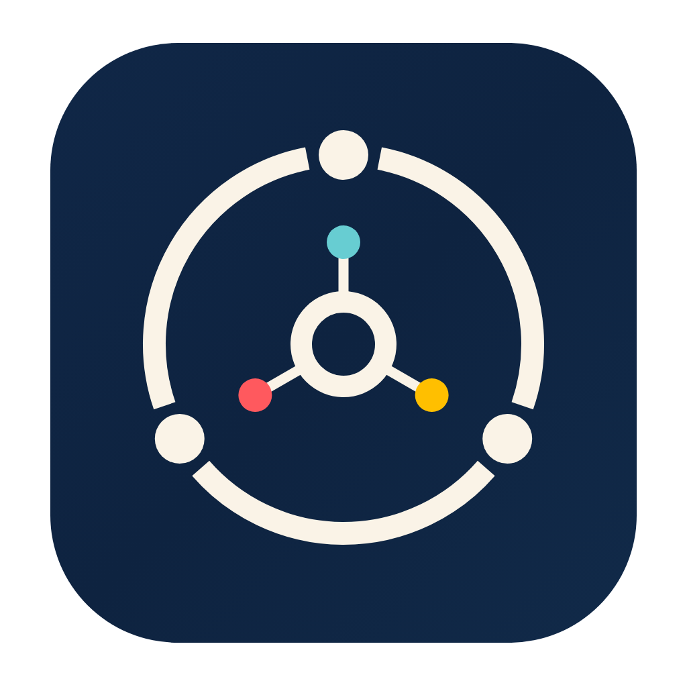
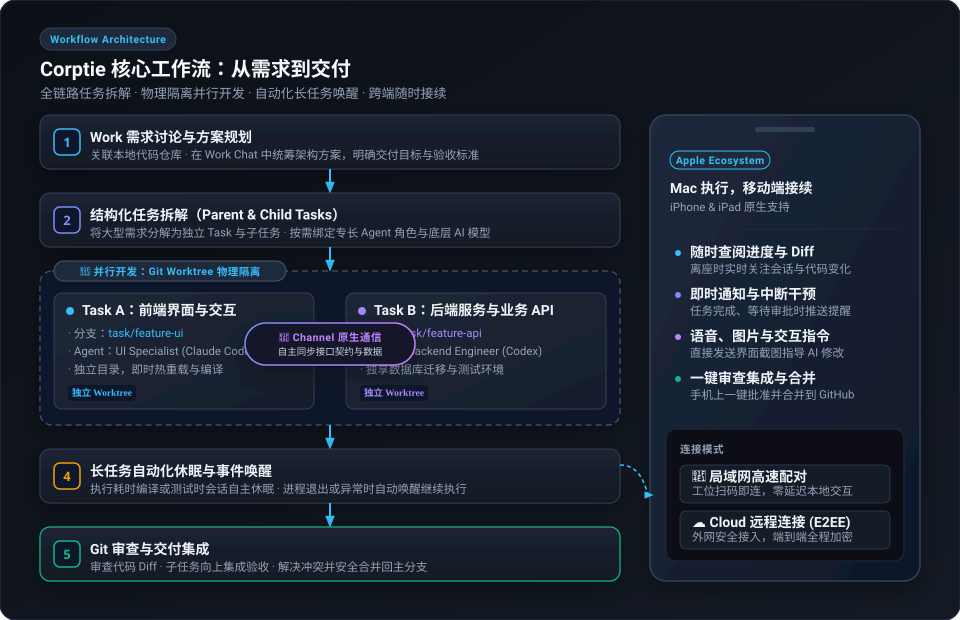
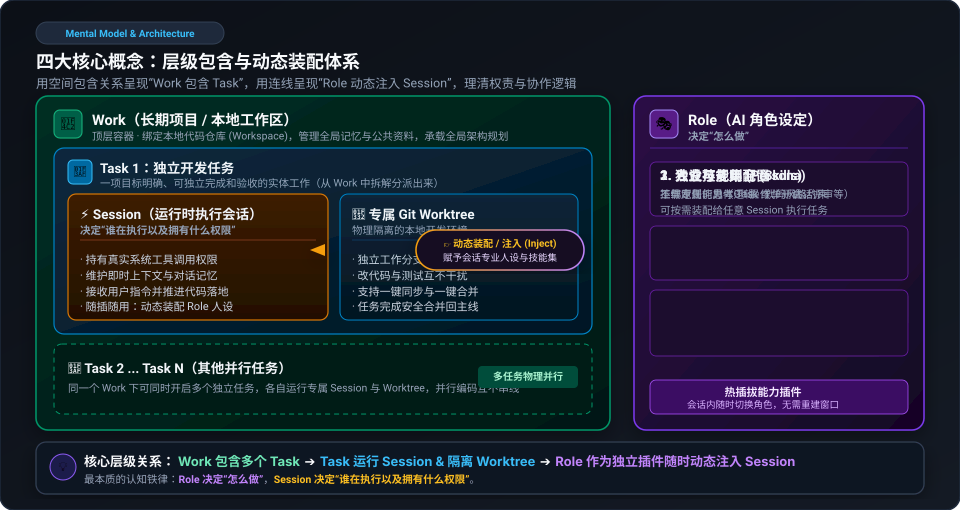
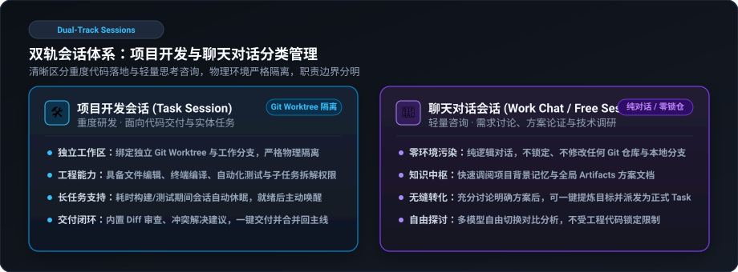
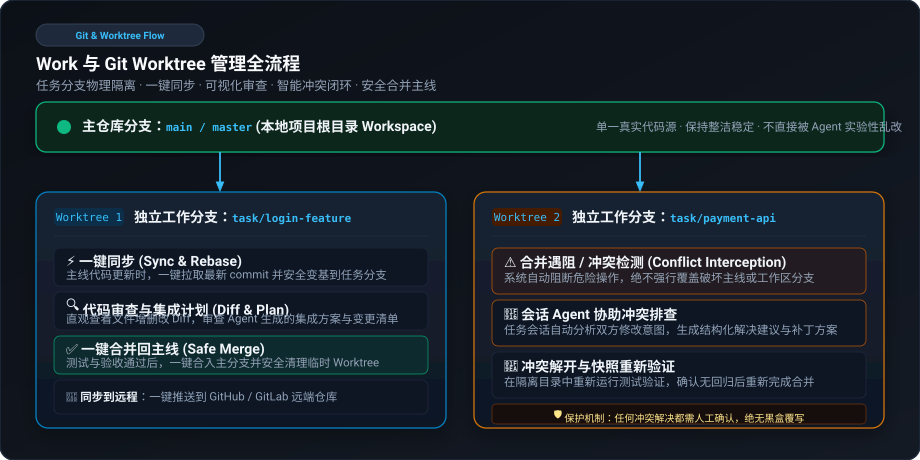
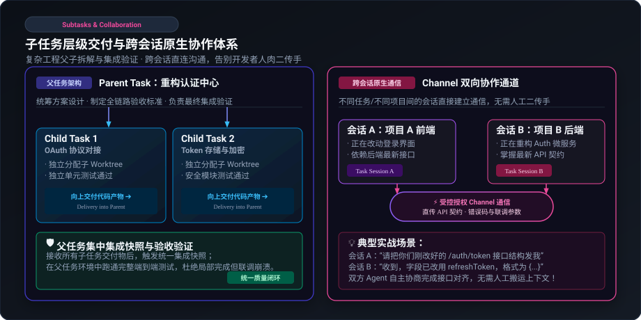
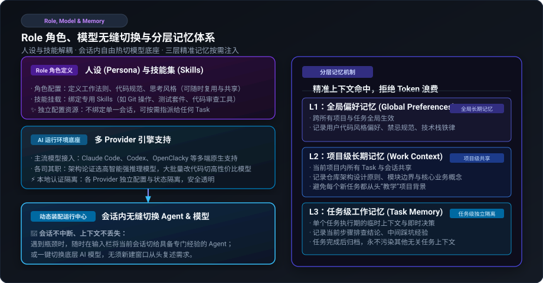
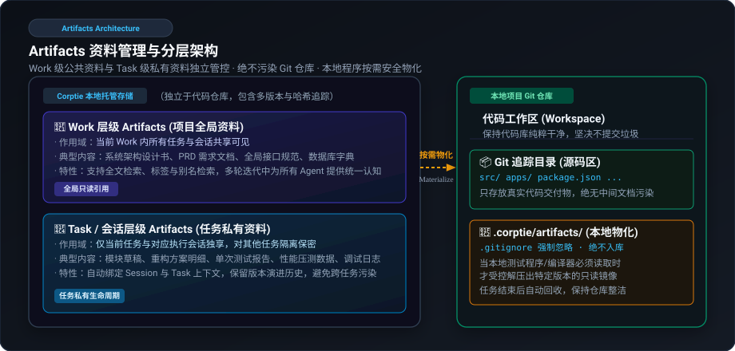

<p align="center">
  
</p>

<h1 align="center">Corptie</h1>

<p align="center">
  <strong>面向专业开发者的多 Agent 协同与并行开发工作台</strong>
</p>

<p align="center">
  <a href="https://github.com/soapjk/corptie/releases">下载最新版本</a>
  ·
  <a href="README.en.md">English</a>
</p>

Corptie 将项目、任务拆解、多 AI 会话与 Git 工具链深度整合。不仅能在桌面端通过独立的 Git Worktree 安全地并行推进多个任务，还支持在长时间任务中自动休眠与唤醒、跨会话直接协作；离座时，更能通过 iPhone 或 iPad 随时接续推进。

---

## 核心工作流全景

Corptie 围绕 **Work（项目/工作区）** 与 **Task（任务）** 建立清晰的开发闭环：

<p align="center">
  
</p>

---

## 核心心智模型：学会区分四个概念

在深入使用前，理清 Corptie 的四个核心概念及其空间层级与装配关系，能帮助你准确理解其设计理念：

<p align="center">
  
</p>

* **层级包含关系**：**Work 是顶层项目容器**（绑定本地代码仓库），一个 Work 拆解并包含多个具体的 **Task**；每个 Task 在内部拥有独立的 Git Worktree 物理隔离环境，并由该 Task 派生运行的 **Session** 负责具体执行。
* **独立装配关系**：**Role 是独立于具体任务的人设与技能资源**，它不固定绑定单一会话，而是像插槽一样**随时动态注入 Session**，使 Session 获得特定领域的工作法则与工具集。

| 概念 | 你可以理解成 | 在 Corptie 中的核心职责 |
| :--- | :--- | :--- |
| **Work** | 一个长期项目（顶层容器） | 绑定本地代码仓库，承载全局架构讨论，维护项目级长期记忆与公共资料，包含多个 Task。 |
| **Task** | 一项可独立完成和验收的工作 | 隶属于 Work，拥有专属的 Git Worktree 隔离开发环境与独立分支，具备清晰的验收闭环。 |
| **Role** | AI 的职责与工作方式（能力插件） | 人设指令、编程准则与技能集合（Skills），随时可热插拔装配给任意 Session。 |
| **Session** | 真正执行操作和保存上下文的会话 | 隶属于 Task，持有系统执行权限，动态装配 Role 与底层模型，与用户对话并落地代码。 |

> **💡 最关键的核心认知**：
> **Role 决定“怎么做”，Session 决定“谁在执行以及拥有什么权限”。**
> Work 提供项目底座，Task 提供物理隔离；Session 负责在 Task 中推进，而 Role 随时为 Session 提供专业技能与思考方式。

---

## 双轨会话体系：项目开发与聊天对话

Corptie 将会话严格区分为 **项目开发会话** 与 **聊天对话会话** 两类，确保不同场景下的心智模型与物理环境界限分明：

<p align="center">
  
</p>

* **项目开发会话 (Task Session)**：
  * **实体代码交付**：每个开发任务绑定独立的 Git Worktree 与工作分支，享有专用工作目录，修改代码绝不污染主干。
  * **完整工程能力**：具备文件读写、终端构建、执行自动化测试及子任务派发权限。
  * **长任务休眠唤醒**：执行耗时编译或测试时自动休眠，避免资源空耗，结果产出后自动唤醒继续执行。
* **聊天对话会话 (Work Chat / Free Session)**：
  * **纯思考咨询**：面向架构论证、需求调研与技术咨询，不锁定、不修改任何本地代码仓库。
  * **知识共享中枢**：直接访问当前项目的记忆背景与全局 Artifacts 方案。
  * **无缝派发任务**：在对话中理清思路后，可直接将讨论成果一键提炼并派发为具体的项目开发任务。

---

## Work 与 Git Worktree 物理隔离管理

告别单工作区频繁切换分支的混乱。Corptie 为每个开发任务（Task）分配独立的 Git Worktree 与工作分支，提供原生、安全的 Git 全生命周期管理：

<p align="center">
  
</p>

* **⚡ 一键同步 (Sync & Rebase)**：主仓库主线（main / master）有更新时，一键拉取最新 commit 并平滑变基到当前 Worktree 分支，时刻保持基底最新。
* **🔍 代码审查与集成计划 (Diff & Plan)**：内置直观的可视化代码对比视图，精准审查 Agent 生成的修改 Diff 与交付方案。
* **✅ 一键合并回主线 (Safe Merge)**：测试与验收通过后，一键安全合入主分支，并自动清理临时 Worktree 目录。
* **⚠️ 冲突拦截与 Agent 协助处理 (Conflict Assistance)**：遇到合并冲突时系统自动安全阻断，绝不强制覆盖；任务会话内的 Agent 会主动分析双方修改意图，提出结构化解冲突建议与修复补丁，经人工确认后完成合并。

---

## 子任务层级交付与跨会话原生协作

面对复杂工程，Corptie 支持结构化拆解与跨会话原生直连，打破传统多窗口切换的人肉二传手模式：

<p align="center">
  
</p>

### 🌿 子任务（Parent / Child Tasks）层级分发与集成
* **方案与实现解耦**：父任务负责系统级设计与总体验收，自主将复杂需求拆解为专注的子任务（如 OAuth 协议对接、Token 加密存储）。
* **独立子 Worktree 开发**：子任务拥有各自独立的开发空间，独立测试通过后向上交付代码产物。
* **集中集成快照验收**：父任务接收所有交付后，自动触发集成快照并在父任务环境中执行端到端集中验证，杜绝局部完成但集成崩溃。

### 💬 跨会话原生通信通道（Channel）
* **受控直连通信**：前端任务会话与后端任务会话可直接建立 Channel 通信，自主对齐数据结构。
* **告别人肉传话**：前端向后端提需求：“请把刚改的 `/auth/token` 接口字段格式同步给我”，后端会话改完即刻回传契约定义，双方无缝完成联调。

---

## Role 角色、模型无缝切换与分层记忆体系

同一个任务在不同阶段往往需要不同的专长角色与模型能力，Corptie 实现了角色、模型底座与会话的彻底解耦：

<p align="center">
  
</p>

### 🔄 会话内无缝热切 Agent 与模型
* **无缝切换 Agent 角色**：会话中随时更换不同的人设（Persona）、工作规则与技能集合（Skills），无需重建会话或丢失历史上下文。
* **自由切换底层模型**：支持在 Codex、Claude Code、OpenClacky 等主流 AI 运行环境之间自由切换。架构论证选强推理模型，大批量搬运代码切高性价比模型。

### 🧠 三层精准记忆架构
* **L1 全局偏好记忆 (Global Preferences)**：跨所有项目与任务全局生效，记录用户个人的编码风格、技术选型铁律与禁忌。
* **L2 项目级长期记忆 (Work Context)**：当前项目内所有 Task 共享，沉淀核心模块边界与业务设计原则，新任务无需从头解释背景。
* **L3 任务级工作记忆 (Task Memory)**：单个任务执行期的临时上下文与即时决策，任务完成后归档，永不污染其他任务。

---

## Artifacts 资料管理与安全物化

代码属于 Git，而设计草稿、接口文档、敏感临时数据不宜污染仓库。Corptie 建立了独立的 Artifacts 分层管理体系：

<p align="center">
  
</p>

* **分层管理作用域**：
  * **Work 层级 Artifacts**：面向项目全局的只读参考资料，如系统架构设计书、PRD、接口规范，供所有任务和会话调阅。
  * **Task 层级 Artifacts**：面向当前任务私有的中间交付物，如重构方案明细、单次覆盖率报告、调试日志，独立保留演进历史。
* **安全物化机制 (Materialize)**：
  * 平时资料统一保存在 Corptie 本地托管存储中，不占用代码目录；
  * 仅当本地编译器或测试脚本明确需要读取时，才安全物化至受忽略的 `.corptie/artifacts/` 目录；
  * 绝不进入 Git 历史，任务结束后自动安全回收，保持源码仓库绝对纯粹。

---

## 自动化唤醒与苹果生态随身接续

### ⏰ 长任务自动唤醒（无需守着终端）
* **主动休眠**：执行长时间的大型构建、测试套件或持续集成任务时，AI 会话自动休眠，不空耗算力与 Token 轮询。
* **事件唤醒**：配置进程监控或自动化条件，任务完成、退出或遇到报错时，系统立即唤醒会话继续下一步工作。

### 📱 苹果全家桶移动端支持（Mac 执行，移动端接续）
重度编译与推理在桌面端运行，移动端提供无缝的随身跟进与控制体验：
* **随身掌控**：在 iPhone 或 iPad 上实时查看任务进度、查阅代码 Diff、发送文字/图片截图指导修改、停止异常任务。
* **安全灵活的双连接模式**：
  * **局域网配对**：在工位通过扫码直接与 Mac 建立高速本地连接，零延迟即时交互。
  * **Cloud 远程连接**：登录同一账号后，在外网也可通过端到端加密（E2EE）安全接入家中的 Mac。
* **状态即时触达**：任务完成、遭遇阻碍或需要审批时，移动端即时推送通知，点击直达会话。

---

## 开始使用

### 运行环境要求
* **macOS 14 或更高版本**（推荐 Apple Silicon Mac）。
* 已安装并完成认证的 AI 运行环境（Codex、Claude Code 或 OpenClacky 至少一个）。

### 快速开始
1. 从 [GitHub Releases](https://github.com/soapjk/corptie/releases) 下载并安装 Corptie。
2. 打开应用，确认本地服务与已安装的 AI 运行环境状态正常。
3. 创建一个 **Work**，绑定你的本地代码仓库。
4. 创建 **Task** 明确开发目标，分配 Agent 并开启会话，开始并行研发。

---

## 源码运行与开发

### 编译依赖
* Node.js 22.13+（支持内置 `node:sqlite`）
* Swift 6 工具链
* Rust / Cargo
* Python 3
* （可选）移动端开发需要 Xcode 及对应调试证书

### 一键开发命令
项目根目录提供了便捷的 `Makefile` 指令：

```sh
# 安装依赖并构建原生模块
npm ci --prefix apps/backend
npm --prefix apps/backend run build:native

# 启动开发环境（自动启动后端服务与 macOS App）
make dev

# 修改代码后重新编译并重启开发 App
make restart

# 运行后端单元测试
make test

# 部署并调试移动端（iPhone / iPad）
make mobile
# 如有多台设备可指定设备：make mobile DEVICE="设备名或UDID"
```

更多开发脚本与高级配置说明，可查阅 [Makefile](Makefile) 与 [scripts](scripts) 目录。

---

## 开源协议

本项目采用 [Apache-2.0](LICENSE) 协议开源。
